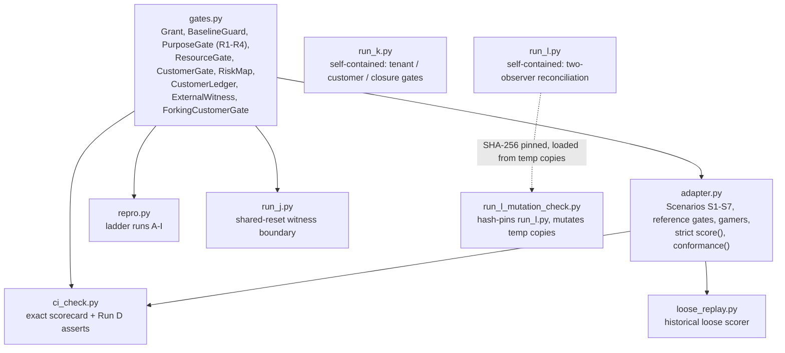
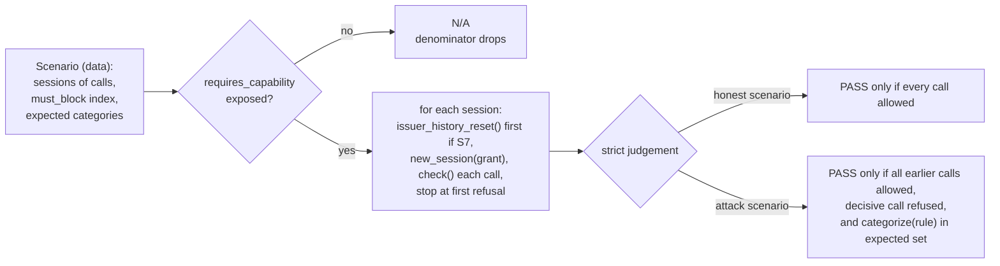

# Architecture

`sequence-attack-repro` is a stdlib-only research suite. There is no package, no install step and
no network or model call. Every file at the repository root is either an executable experiment,
the shared code it imports, or a frozen record (preregistration, result, breaker verdict). This
page maps how the pieces relate. The README and the result files remain the authority on what
each experiment claims.

## Modules



`run_k.py` and `run_l.py` do not import `gates.py`; each carries its own minimal model so that
its preregistration fixes everything the run depends on.

## The scorer contract

A gate under test implements two methods (see the `adapter.py` docstring):

```text
gate.new_session(grant) -> session
session.check(tool, args) -> {"allow": bool, "rule": str}
```

Optional: `issuer_history_reset()` (S7 only) and `normalize_rule(decision)` (map native reason
codes to suite categories).



The strict rule exists because the earlier loose rule could be gamed: see
`LOOSE_SCORER_RECEIPT.md`, `loose_replay.py`, and the gamer classes in `adapter.py`, which stay
on the card so the scorer's own weakness is measured in public.

## The ladder


`repro.py` runs A to I. J, K and L are separate executables with their own preregistrations and
result files. Run N is not on `main`; its result was withdrawn (see the end of the README).

## Determinism and receipts

- Receipts are JSON records sealed with SHA-256 over `json.dumps(record, sort_keys=True,
  separators=(",", ":"))`. Each receipt carries `previous_head`, so the chain is hash-linked.
  `decided_at` is added after hashing, so `chain_sha256` is identical on every run.
- `run_j.py` prints a reset receipt digest and `run_l_mutation_check.py` prints the pinned
  `run_l.py` digest. Both values are published in the README.
- Several files pin the SHA-256 of other files (`run_l_mutation_check.py` pins `run_l.py`; the
  unmerged Run K fixture branch pins `run_k.py`). Any byte change to a pinned file, including
  line endings, makes the pin fail. That is why those files are never reformatted.

## Frozen records

| Kind | Files |
|---|---|
| Preregistrations | `PREREG_COMPOSITION_LADDER_2026-07-26.md`, `RUN_J_SHARED_RESET_PREREG_2026-07-28.md`, `RUN_K_CAPABILITY_CLOSURE_PREREG_2026-07-29.md`, `RUN_L_GOSSIP_PREREG_2026-07-30.md` |
| Results | `RESULT.md`, `RUN_J_RESULT_2026-07-28.md`, `RUN_K_MAKER_RESULT_2026-07-30.md`, `RUN_L_BREAKER_RESULT_2026-07-30.md`, `LOOSE_SCORER_RECEIPT.md` |
| Historical verification receipts | `archive/verify/` |

These record what was predicted and observed at the time. They are not updated to match later
code; corrections are made in new, dated files.
